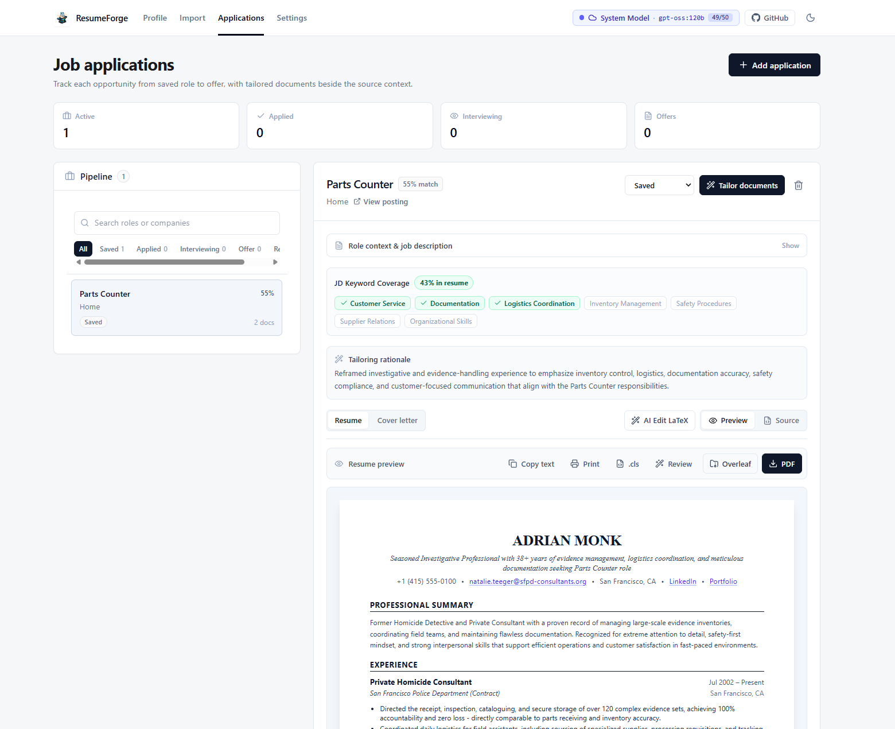
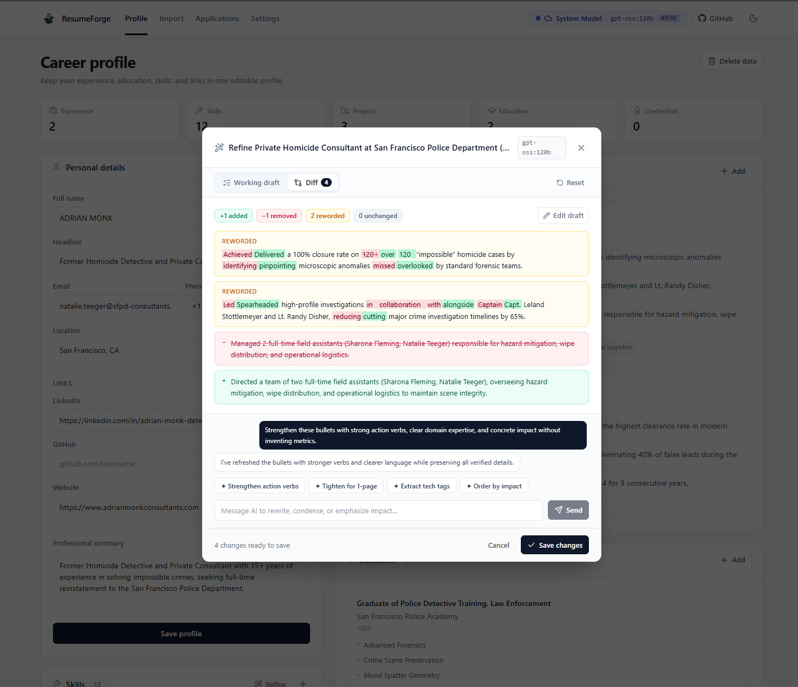
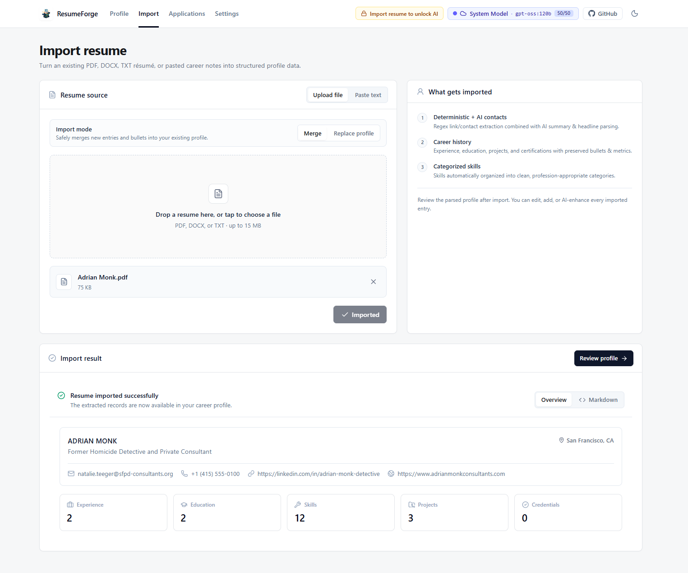
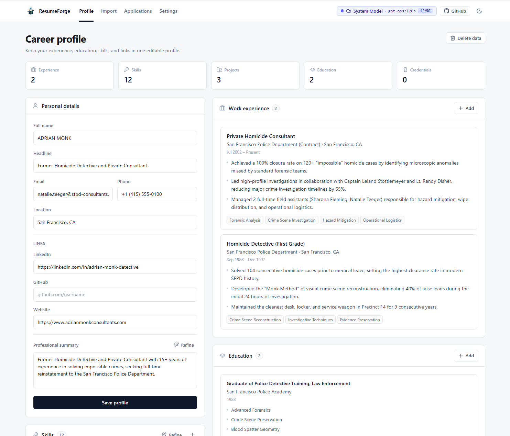

<div align="center">

# ResumeForge 🛠️📄

**Open-Source AI-Powered Resume Builder & Job Application Tracker**  
Tailor targeted, ATS-friendly LaTeX & PDF resumes and cover letters using local or remote **Ollama** models.

[](./LICENSE)
[](./CONTRIBUTING.md)
[](https://github.com/naveedkhan1998/resume-forge/actions/workflows/backend-docker.yml)
[](https://react.dev/)
[](https://django-ninja.dev/)
[](https://github.com/pgvector/pgvector)

[Features](#-features) • [Screenshots](#-screenshots) • [Quickstart](#-quickstart) • [Architecture](#️-architecture--monorepo-layout) • [Ollama Setup](#-ollama-configuration) • [Deployment](#-deployment) • [Contributing](#-contributing)

<br />



</div>

---

## 📸 Screenshots

| **1. AI Section Refinement with Word-Level Diffs** | **2. Job Tailoring, Keyword Coverage & Live Preview** |
| :---: | :---: |
|  |  |
| *Iterate on bullet points with AI and inspect word-by-word additions, removals, and rewordings before saving.* | *Analyze JD keyword coverage, view tailoring rationale, and export ATS-ready LaTeX, Overleaf ZIPs, or PDFs.* |

| **3. Resume Import & Auto-Parsing** | **4. Master Career Profile** |
| :---: | :---: |
|  |  |
| *Upload existing PDF, DOCX, or TXT resumes to automatically extract structured career history and skills.* | *Maintain a single source-of-truth profile with all your roles, achievements, projects, and credentials.* |

---

## ✨ Features

- **🤖 Local & Remote AI (Ollama + Fallback Support)**: Works out of the box with local or remote **Ollama** models (`qwen3.5:9b`, `llama3`, `gemma4`, etc.) with full privacy, plus optional server-side fallback support.
- **📄 Resume Ingestion & Auto-Parsing**: Upload existing `PDF`, `DOCX`, or `TXT` resumes and automatically extract structured personal info, work experience, skills, education, and projects.
- **🗂️ Master Baseline Context**: Maintain an exhaustive, single source-of-truth career profile with all your roles, achievements, and projects.
- **✨ Section-Level AI Refinement**: Edit any experience or section manually or iterate with targeted AI prompts (*"Rewrite bullets with STAR metrics"*, *"Emphasize distributed systems architecture"*).
- **🎯 Job Tracker & Smart Tailoring**:
  - Track applications across a status pipeline (**Saved**, **Applied**, **Interviewing**, **Offer**, **Rejected**).
  - Paste a job description to compute candidate match scores and keyword alignment.
  - AI intelligently selects, reorders, and tailors relevant bullets to fit a clean, targeted resume without inventing unsupported skills or metrics.
- **📐 ATS-Friendly LaTeX & PDF Export**: Generates clean, battle-tested LaTeX source code and instant PDF previews for both Resumes and Cover Letters.
- **🧠 PostgreSQL + `pgvector`**: Unified database storing both relational records and semantic vector embeddings.

---

## 🚀 Quickstart

### Prerequisites

- **[Node.js](https://nodejs.org/)** (v20+) & **npm**
- **[Docker & Docker Compose](https://www.docker.com/)** (runs PostgreSQL `pgvector` and the backend API container automatically)
- **[Ollama](https://ollama.ai/)** (optional, for local AI inference)

### Step-by-Step Setup

#### 1. Clone the repository and `cd` into it
```bash
git clone https://github.com/naveedkhan1998/resume-forge.git
cd resume-forge
```

#### 2. Install dependencies first
```bash
npm i
```

#### 3. Configure environment variables *(optional)*
Default development values work out of the box, or you can copy `.env.example` to customize ports, database credentials, or LLM endpoints:
```bash
cp .env.example .env
```

#### 4. Start the development servers
```bash
npm run dev
```

That's it! `npm run dev` uses **Nx** to concurrently launch:
- **Frontend Web App**: [http://localhost:4200](http://localhost:4200) (React + Vite with hot reload)
- **Backend API & Database**: [http://localhost:8000/api/docs](http://localhost:8000/api/docs) (Dockerized Django Ninja API + PostgreSQL `pgvector` with automatic database migrations on startup)

---

### Alternative: Running the Backend Directly on Host (Without API Docker Container)

If you prefer running the Python backend directly on your host machine using [uv](https://github.com/astral-sh/uv):

```bash
# 1. Start only the PostgreSQL (pgvector) database container
docker compose up -d db

# 2. Create a Python 3.12 virtual environment and install backend dependencies
uv venv --python 3.12 .venv
uv pip install -e apps/api

# 3. Run database migrations
npm run migrate

# 4. Run frontend and local backend
npm run dev:web        # Terminal 1: http://localhost:4200
npm run dev:api:local  # Terminal 2: http://localhost:8000
```

---

## 📜 Available Scripts

All commands are run from the project root after running `npm i`:

| Command | Description |
| :--- | :--- |
| `npm i` | Install all workspace Node.js & Nx dependencies |
| `npm run dev` | Start both **Frontend** (`:4200`) and **Dockerized Backend + DB** (`:8000`) in parallel |
| `npm run dev:web` | Start only the Vite React frontend (`http://localhost:4200`) |
| `npm run dev:api` | Build and start the Dockerized API + PostgreSQL (`pgvector`) stack (`http://localhost:8000`) |
| `npm run dev:api:local` | Run the Django development server directly from `.venv` on the host |
| `npm run build` | Build all applications in the monorepo |
| `npm run build:web` | Build the production frontend bundle (`dist/apps/web`) |
| `npm run migrate` | Run Django database migrations using `.venv` |
| `npm run makemigrations` | Create new Django database migrations using `.venv` |
| `npm run docker:up` | Start Docker Compose services in detached mode |
| `npm run docker:down` | Stop and remove Docker Compose containers |
| `npm run docker:logs` | Tail logs from running Docker Compose containers |

---

## 🏗️ Architecture & Monorepo Layout

Managed with **Nx Monorepo**:

```text
resume-forge/
├── apps/
│   ├── web/                    # React 19 + Vite + Tailwind CSS v4 + Lucide UI
│   └── api/                    # Django 5 + Django Ninja + PostgreSQL (pgvector)
├── docker/
│   ├── Dockerfile.backend      # Python 3.12 + uv + Gunicorn production/dev image
│   └── entrypoint.sh           # Auto-enables pgvector extension & runs migrations
├── docs/
│   └── screenshots/            # Application UI screenshots for documentation
├── .github/
│   ├── ISSUE_TEMPLATE/         # Bug report & feature request templates
│   ├── PULL_REQUEST_TEMPLATE.md
│   └── workflows/              # CI/CD workflows (Docker Hub automated builds)
├── docker-compose.yml          # PostgreSQL (pgvector) + Backend API services
├── package.json                # Monorepo scripts & dependencies
├── CONTRIBUTING.md             # Contributor guide & workflow
├── CODE_OF_CONDUCT.md          # Contributor Covenant Code of Conduct
├── SECURITY.md                 # Security policy & vulnerability reporting
└── LICENSE                     # MIT License
```

---

## 🤖 Ollama Configuration

1. Ensure your [Ollama](https://ollama.ai/) service is running and pull a model:
   ```bash
   ollama run qwen3.5:9b
   # Or any model of your choice:
   # ollama run llama3:latest
   # ollama run qwen2.5-coder:14b
   ```
2. Inside the ResumeForge web UI, open **AI Settings** to test connectivity and select your preferred model.
   - **Host Native API**: Use `http://localhost:11434`
   - **Dockerized API (`npm run dev`)**: Use `http://host.docker.internal:11434` (configured automatically in `docker-compose.yml`)
3. **Recommended Settings**: For lightweight models, use a temperature between `0.1` and `0.3`. ResumeForge requests structured JSON, validates required fields, and automatically performs a focused repair pass if a model returns malformed JSON.

---

## 🌐 Deployment

### Backend Docker Image
A prebuilt backend image is published via GitHub Actions to Docker Hub:
```bash
docker pull naveedkhan1998/resume-forge-backend:latest
```

### Frontend Cloudflare Pages Deployment
The frontend (`apps/web`) can be deployed directly to **Cloudflare Pages**:

```bash
# Preview production build locally with Wrangler
npm run pages:preview

# Deploy to Cloudflare Pages
npm run pages:deploy
```

**Cloudflare Dashboard Git Integration Settings:**
- **Framework preset**: `None` / `Vite`
- **Build command**: `npm run build:web`
- **Build output directory**: `dist/apps/web`
- **Root directory**: `/`

---

## 🤝 Contributing

We welcome contributions from the community! Whether it's fixing bugs, adding resume templates, improving AI parsing prompts, or enhancing documentation:

1. Read our **[Contributing Guide](./CONTRIBUTING.md)** for development setup and PR conventions.
2. Please follow our **[Code of Conduct](./CODE_OF_CONDUCT.md)**.
3. For security issues, please refer to our **[Security Policy](./SECURITY.md)**.

---

## 📜 License

Distributed under the **MIT License**. See [`LICENSE`](./LICENSE) for full details.
